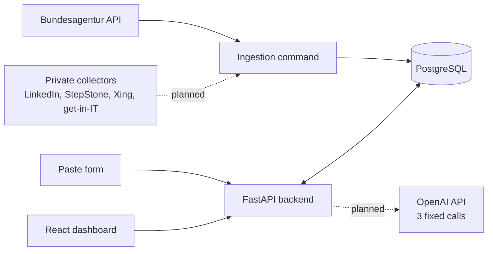

# Job Intelligence Assistant

A personal tool for my own job search in Germany. It collects new job postings from several sources, shows only the ones that fit my profile, and drafts application documents from my real experience. I use it every day; it is not a product.

The repo is public for a second reason: it shows how I build software with [Claude Code](https://claude.com/claude-code) and a set of engineering skills (see [How it is built](#how-it-is-built)).

**Status:** work in progress. The database, the backend API and the dashboard exist. Job ingestion is being built now. The plan is in [docs/roadmap.md](docs/roadmap.md).

## The problem

Searching for jobs by hand means checking the same boards every day, reading the same postings twice, and losing track of which version of a posting I applied to. Most postings are not a good fit, and finding the few that are takes most of the time.

## What it does

| Part | What it does | State |
| --- | --- | --- |
| Ingestion | Fetches postings from the Bundesagentur für Arbeit (including jobs it copies from other boards) and from a paste form. Recognises the same job across sources and cities | In progress |
| Collectors | Daily collectors for LinkedIn, StepStone, Xing and get-in-IT, in a separate private repo | Planned |
| Profile | My skills, projects and experience, each with evidence | Partly built |
| Fit score | Extracts requirements from a posting and checks them against my evidence. Only jobs at or above 50% are shown, with the reasons | Planned |
| Documents | CV and cover letter drafts in Word and PDF, in the posting's language, using only real evidence | Planned |
| Applications | I record my decision per job with a manual status. The exact posting text is kept for each application | Built |

What it deliberately does not do: it never applies automatically, never invents experience, and has no AI agent. The workflow is plain code, and an LLM is called in three fixed places only.

## Architecture



- **Backend:** Python, FastAPI, SQLAlchemy 2, Alembic, pytest
- **Database:** PostgreSQL 17 in Docker
- **Frontend:** React 19, TypeScript, Vite, Tailwind
- **Hosting (planned):** Azure

More detail: [docs/architecture.md](docs/architecture.md), [docs/api.md](docs/api.md), [docs/product-definition.md](docs/product-definition.md).

## Running it locally

Commands are for Windows (cmd). You need Python 3, Node.js and Docker Desktop.

```cmd
:: 1. Settings and database (from the repo root)
copy .env.example .env
docker compose --env-file .env -f infra/docker-compose.yml up -d

:: 2. Backend (from backend\)
cd backend
python -m venv .venv
.venv\Scripts\activate
pip install -r requirements.txt
alembic upgrade head
uvicorn app.main:app --reload

:: 3. Frontend (from frontend\, in a second terminal)
cd frontend
npm install
npm run dev
```

The API runs on http://localhost:8000 (interactive docs at `/docs`) and the dashboard on http://localhost:5173.

### Tests

Tests use a separate database, `jobintel_test`. Create and migrate it once:

```cmd
docker compose --env-file .env -f infra/docker-compose.yml exec db createdb -U jobintel jobintel_test
cd backend
set POSTGRES_DB=jobintel_test
alembic upgrade head
set POSTGRES_DB=
pytest
```

Each test runs in a transaction that is rolled back, so the test database stays empty.

## How it is built

The app is built with Claude Code, the command-line coding agent, following [Matt Pocock's engineering skills](https://github.com/mattpocock/skills). Claude Code only builds the app; nothing from it runs inside the app.

| Stage | Skill | Output in this repo |
| --- | --- | --- |
| Align | `/grilling` | Decisions in the roadmap's decision log |
| Plan | `/to-spec`, `/to-tickets` | A spec and numbered tickets in `.scratch/<feature>/` |
| Build | `/implement`, `/tdd` | Code and tests, one ticket at a time |
| Check | `/code-review` | Review against the spec and the repo's rules |

- [CLAUDE.md](CLAUDE.md) holds the standing rules: the stack, the commands, what must never be built, and which decisions Claude Code has to ask me about (data model, screens, prompts and scoring, hosting and cost).
- [docs/agents/](docs/agents/) tells the skills where tickets live and how they are labelled.
- Tickets are local markdown files, for example [the ingestion spec](.scratch/ingestion/spec.md) and [its tickets](.scratch/ingestion/issues/).

## Privacy

My real profile, search settings, cover letter instructions and secrets never enter this repo. They live in the local database or in configuration files ignored by git, and the repo contains only example data.
