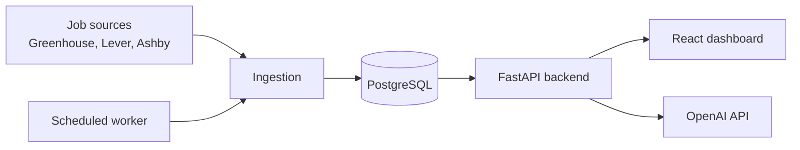

# Architecture (draft)

This is the planned shape, not the current state.

Implemented so far: PostgreSQL, SQLAlchemy models, Alembic migrations, and a
FastAPI backend (jobs, candidate profile, applications). Not yet built:
ingestion, the worker, the LLM and agent parts, and the React dashboard.