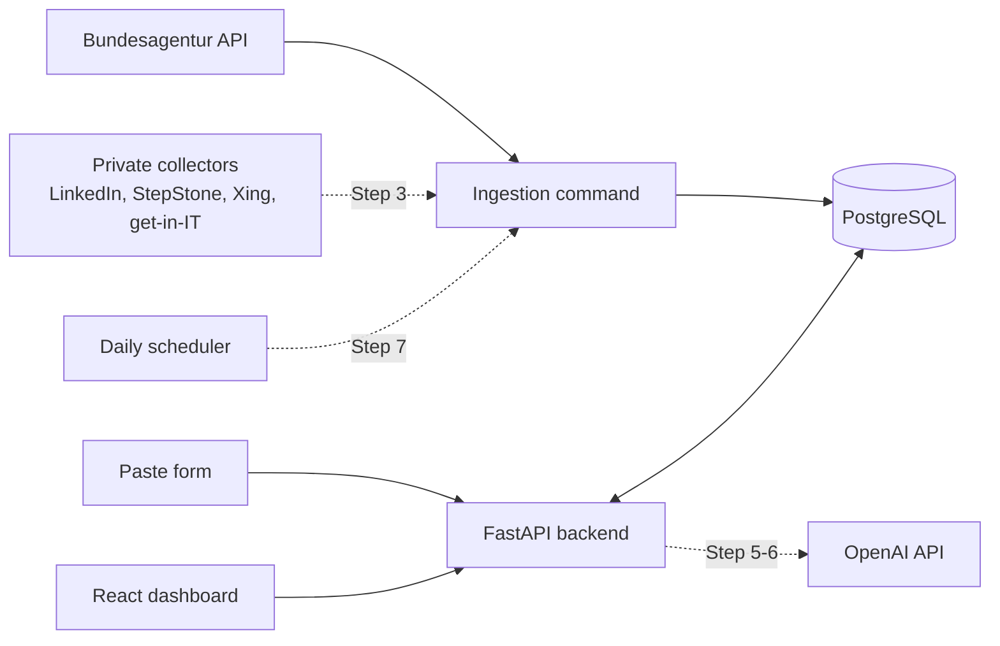

# Architecture

Solid lines exist or are being built now. Dotted lines are planned; the step numbers refer to [roadmap.md](roadmap.md).

## Built so far

- **Database:** PostgreSQL 17 in Docker, with Alembic migrations. Tables: `companies`, `job_postings`, `job_posting_snapshots`, `candidate_profiles`, `applications`.
- **Backend:** FastAPI with read-only jobs, a candidate profile, and applications with six manual statuses. See [api.md](api.md).
- **Dashboard:** React with Jobs, Job Detail, Applications and Profile pages.
- **Tests:** pytest against a separate test database, each test in a rolled-back transaction.

## Key design rules

- **Snapshots:** the text of a posting is stored as a snapshot and never overwritten. An application pins the snapshot it was made for.
- **Ingestion (Step 2):** source adapters only fetch and map data; one shared storage function decides what is new. The same job is the same cleaned-up title and company, across sources and cities. Details: [the ingestion spec](../.scratch/ingestion/spec.md).
- **No agent:** the workflow is deterministic code. The LLM is called in three fixed places (requirement extraction, classification against profile evidence, drafting and checking documents), with no tools.
- **Private parts:** collectors that read sites without an official API live in a separate private repo and load as adapters when present. Personal data and search settings stay out of this repo.

## Not built yet

Ingestion, the collectors, profile evidence, the fit score, document generation, the daily scheduler, login and deployment on Azure.
